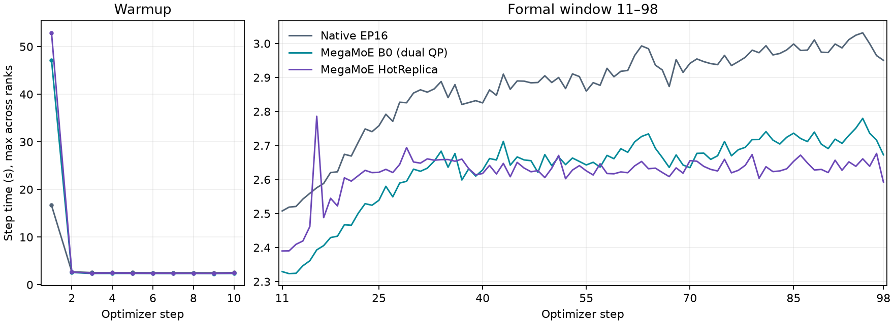
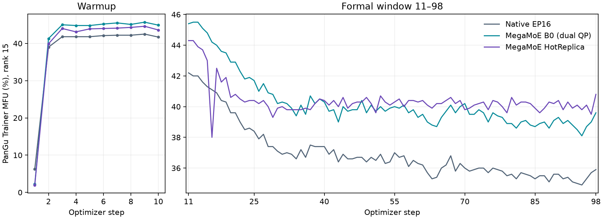
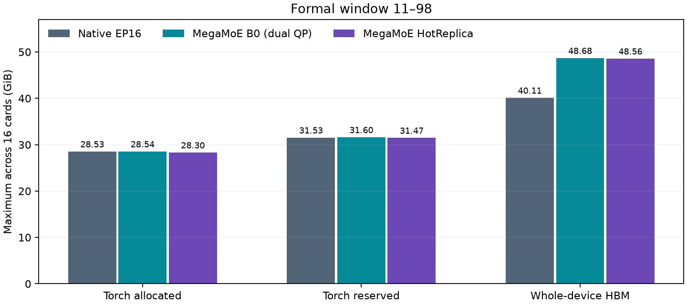
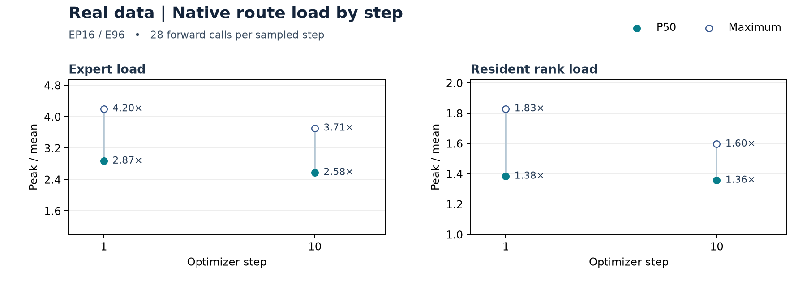
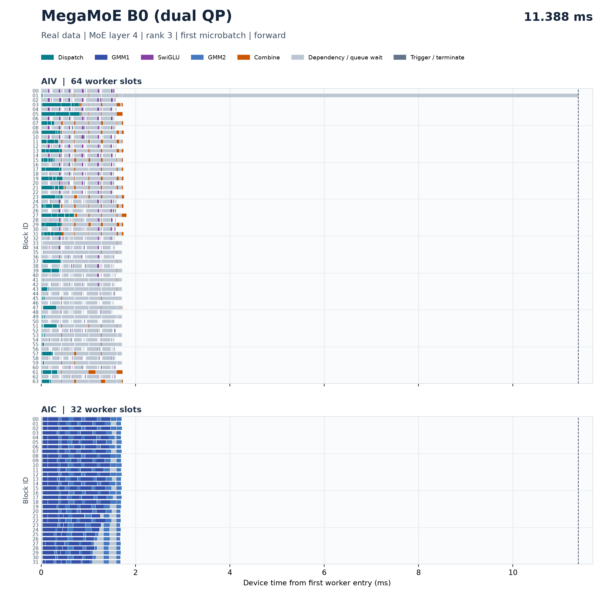
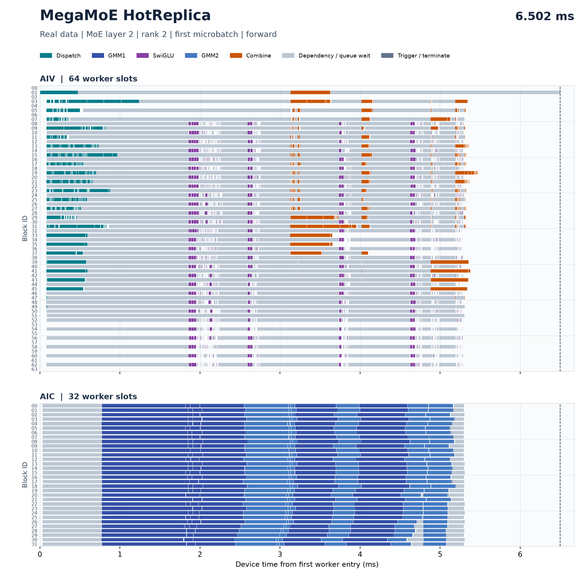
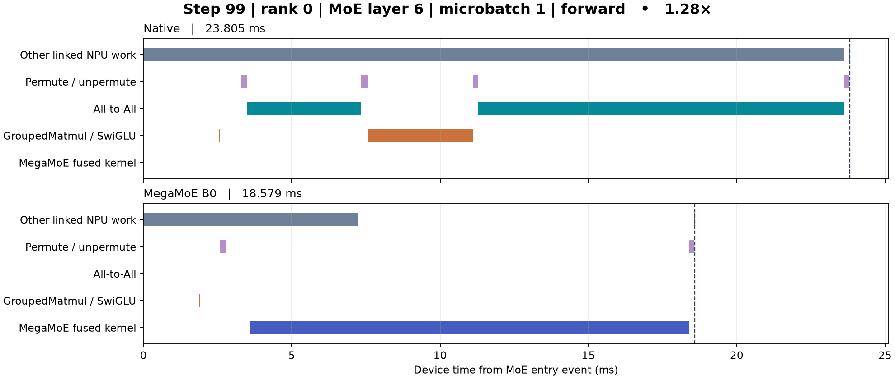
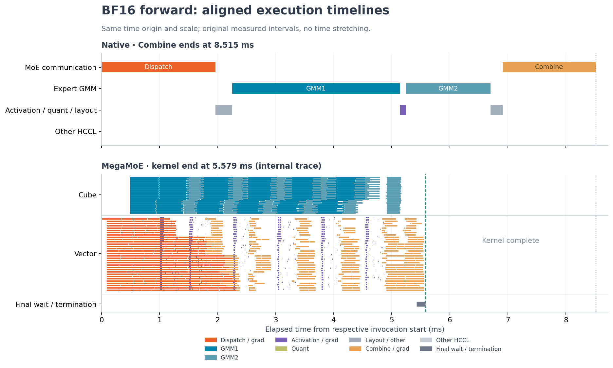
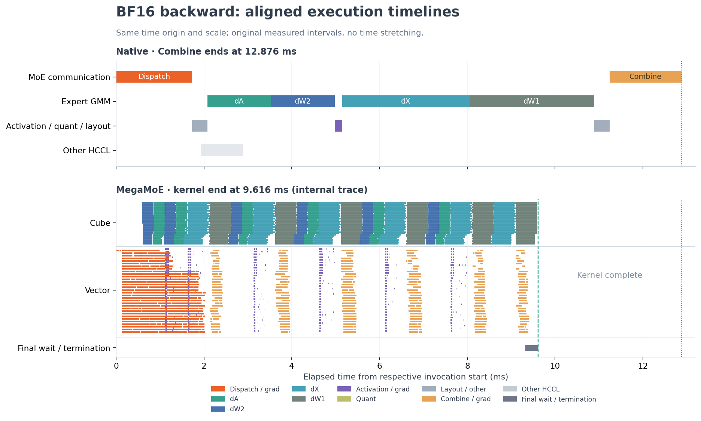

# PanGu A5 双机 MegaMoE 与 Native 性能报告（BF16 真实语料）

实验日期 2026-11-25，运行编号 `20261125-181233-b9fe144e`、`20261125-182238-1906b15c`。

## 1. 核心结论

- **关闭副本的 MegaMoE B0 与 Native 在本轮核对的训练数值上零差异**。第 11–98 步，两项 MTP loss 和 Grad norm 的日志最大绝对差均为 **0**，第 1、10、99 步的 Top-K 哈希也一致。
- **MegaMoE B0（双 QP）** 的正式窗口步时 P50 为 **2.662 秒**，较 Native 的 2.901 秒下降 **8.26%**。
- **MegaMoE HotReplica** 的步时 P50 为 **2.630 秒**，较 Native 降时 **9.35%**，较 B0 再降 **1.19%**。正式窗口 3,644/4,576 次调用实际借槽。
- **第 99 步 profiler** 中，B0 和 HotReplica 的七层 MoE 合计加速比分别为 **1.127×** 和 **1.185×**。正式窗口整卡 HBM 采样峰值依次为 **40.11 / 48.68 / 48.56 GiB**。

## 2. 性能对比

### 2.1 双机 16 卡

双机 Ascend950 DT，各八卡。PanGu BF16，EP16/E96、每 rank 六个常驻专家，TopK8、H5120/I1792、序列 4,096、MBS1、GAS4、GBS64、CP1。七个 MoE，六层完整重算，采用 Muon，Engram 关闭。 真实语料沿用 PanGu packed 样本，每样本取前 4,096 个 token 及后移标签，Router 随训练正常更新。

Native 使用 PanGu 置换、All-to-All 和 GroupedMatmul。两个 MegaMoE 臂共用 Push、1,024 行 Dispatch/Combine 分片、ready lookahead 8、3 µs math polling 和 8 个 UDMA QP 配置。优化 B0 使用双 QP tile 拆分和前向 CountFence，正式窗口命中 73,216 次。HotReplica 使用副本 planner 和常规 Push 队列，整步差值包含这两项调度配置差异。Native 和优化 B0 在同一租约运行，HotReplica 随后在同两节点的独立租约运行。

| 方案 | 对比基线 | 平均单步耗时（s） | 吞吐提升 | Allocated / Reserved（GiB） | 显存节省 Allocated / Reserved |
| --- | --- | --- | --- | --- | --- |
| Native EP16 | — | 2.869 | — | 28.53 / 31.53 | — |
| MegaMoE B0（双 QP） | Native EP16 | 2.631 | +9.03% | 28.54 / 31.60 | -0.02% / -0.24% |
| MegaMoE HotReplica | Native EP16 | 2.620 | +9.49% | 28.30 / 31.47 | +0.80% / +0.18% |

| 方案 | P50 / P95（s） | 输入 tokens/s | PanGu 日志 MFU | 整卡 HBM 采样峰值（GiB） | SHMEM heap 配置（GiB） |
| --- | --- | --- | --- | --- | --- |
| Native EP16 | 2.901 / 3.000 | 91,382 | 36.96% | 40.11 | — |
| MegaMoE B0（双 QP） | 2.662 / 2.736 | 99,633 | 40.28% | 48.68 | 8.00 |
| MegaMoE HotReplica | 2.630 / 2.672 | 100,053 | 40.41% | 48.56 | 8.00 |

### 2.2 专家副本

HotReplica 在正式窗口有 58/88 步比 B0 快。每 rank 有 3,644/4,576 次前向或重算实际走 `fp32_band` 副本协议。第 99 步为 43/52 次。两条 MegaMoE 臂的接收区预留均为 163,840 行，源路由区为 32,768 行，正式窗口零扩容。

每层每微批计算原属 rank 接收量的最大值与均值之比，再在当步样本中取中位。接收量降幅按实际借槽的普通前向统计。

| 采样步 | Native 原属负载峰均比 | HotReplica 落位前峰均比 | 落位后最忙 rank 接收量中位降幅 |
| --- | --- | --- | --- |
| 1 | 1.38× | 1.38× | 30.02% |
| 10 | 1.36× | 1.36× | — |
| 99 | 2.07× | 2.09× | 57.79% |

— 表示当步零次普通前向借槽。

#### 路由负载随训练变化

取 Native 每个采样步的七层 × 四微批，共 28 次普通前向。专家峰均比为最忙专家接收行数除以 96 个专家的均值。每个 rank 汇总六个原属专家的接收行数，再以最忙 rank 除以 16 个 rank 的均值，得到 rank 峰均比。

| 采样步 | 专家峰均比 P50 / 最大 | 原属 rank 峰均比 P50 / 最大 |
| --- | --- | --- |
| 1 | 2.87× / 4.20× | 1.38× / 1.83× |
| 10 | 2.58× / 3.71× | 1.36× / 1.60× |
| 99 | 7.75× / 9.61× | 2.07× / 3.15× |

第 1 到第 10 步，两项峰均比均略降。第 99 步，专家和 rank 峰均比的中位数分别升至 7.75× 和 2.07×，最忙 rank 的单次峰均比达到 3.15×。路由直方图采集于第 1、10、99 步，图中展示前两个采样点。 [路由采样明细](assets/pangu-a5-ep16-bf16-synthetic/route-skew-comparison.json)

### 2.3 统计口径

整步时间来自 PanGu 训练日志。每步先取 16 个 rank 的最大值，再对第 11–98 步统计均值、P50 和 P95。第 1–10 步为预热，第 99 步采 profiler。吞吐按每步 262,144 个输入 token 和正式窗口平均步时折算。MFU 为 rank 15 的 PanGu Trainer 日志值在正式窗口的均值。

表中 allocated 和 reserved 取正式窗口各 rank 的 allocator 高水位最大值。整卡 HBM 用两节点各自的 npu-smi 采样取得。第 99 步的 HBM 采样峰值依次为 40.11 / 48.68 / 48.56 GiB。 [正式窗口审计](assets/pangu-a5-ep16-bf16-real/formal-summary.json) · [逐步 CSV](assets/pangu-a5-ep16-bf16-real/steps.csv)

## 3. 训练数值核对

Native 与 B0 在第 1、10、99 步的 832 个 Top-K 哈希各自全部一致。下表取 rank 15 第 11–98 步的原始训练日志。三臂的学习率在日志精度下逐步一致。 [训练数值回执](assets/pangu-a5-ep16-bf16-real/numeric-audit.json)

| 对照 | MTP head 0 loss 最大绝对差 | MTP head 1 loss 最大绝对差 | Grad norm 最大绝对差 |
| --- | --- | --- | --- |
| Native / MegaMoE B0 | 0 | 0 | 0 |
| Native / MegaMoE HotReplica | 0.018691 | 0.008154 | 2.060806 |
| MegaMoE B0 / MegaMoE HotReplica | 0.018691 | 0.008154 | 2.060806 |

## 4. 配置、数据与日志

- PanGu `0b5e0280ac1ad70d2837b10291c4b3e5ce5c1ff8`，MegaMoE `hot-replica-a5-perf@3d6545d1154a5bfb5ee96b61b62c612ebb7fb023`。 [构建指纹、制品 SHA256 与运行配置](assets/pangu-a5-ep16-bf16-real/provenance.json)
- 逐步 CSV 保留预热、正式窗口及 profiler 步的耗时、MFU、loss、Grad norm 和学习率。 [逐步 CSV](assets/pangu-a5-ep16-bf16-real/steps.csv)
- 三臂 48 个训练 rank 的终态齐全，任务进程清零，两节点共 16 张 NPU 释放。 [运行回执](assets/pangu-a5-ep16-bf16-real/provenance.json)

| 方案 | Trainer case | 路由专家执行 |
| --- | --- | --- |
| Native EP16 | `real-main-native` | PanGu 原生置换、All-to-All、GroupedMatmul |
| MegaMoE B0（双 QP） | `real-main-mega` | `dispatch_mode="push"`，`expert_placement=None` |
| MegaMoE HotReplica | `real-hot-hot` | `dispatch_mode="push"`，`expert_placement=HotReplicaPlanner()` |

### 4.1 Rank 0、8 第 99 步 Level0 Profiling

每份 Trainer trace 的第 99 步标记内有 28 次前向、24 次重算与 28 次路由专家反向。Native 每个采样 rank 在 MoE 范围内有 160 次 `c10d::alltoall_base_`，两个 MegaMoE 臂各有 80 次融合设备内核。

### 4.2 MegaMoE 核内流水

优化 B0 采第 4 层的 rank 3、9，HotReplica 采第 2 层的 rank 2、15。第 2 层由 Native 在第 99 步的原属负载选定。HotReplica 在同一层首微批前向实际使用 15 条副本边，最忙 rank 的接收量从 104,351 行降到 32,768 行。四份核内 trace 均包含前向、重算和反向，且无记录丢失。

| 方案 | MoE 层 | Rank | 前向 / 重算 / 反向（ms） |
| --- | --- | --- | --- |
| 优化 B0 | 4 | 3 | 11.388 / 12.752 / 23.689 |
| 优化 B0 | 4 | 9 | 11.795 / 12.459 / 23.757 |
| HotReplica | 2 | 2 | 6.502 / 7.931 / 10.207 |
| HotReplica | 2 | 15 | 5.853 / 7.925 / 10.118 |

下图各取一次首微批前向。B0 为第 4 层 rank 3，HotReplica 为实际启用副本的第 2 层 rank 2。每条泳道对应一个 AIV 或 AIC 的 block ID，彩色区间为任务执行，灰色区间为等待和调度控制。横轴以各自最早的 worker 进核时刻为零，竖虚线标记最后一条记录结束。两张图各自展示所采层的通算重叠。

## 5. MoE 层加速比

使用第 99 步三臂共同的 12 个 rank，核内采样所在 rank 单列。前向和重算的 NPU Event 覆盖整个 MoE 层，包括 Router、共享专家和路由专家。反向覆盖路由专家 autograd。先按 rank 求和再取中位，倍率为 Native 耗时除以候选耗时。

| 方案 | 前向（ms） | 重算（ms） | 路由专家反向（ms） | MoE 合计（ms） | 合计加速比 |
| --- | --- | --- | --- | --- | --- |
| Native EP16 | 497.1 | 410.4 | 667.2 | 1,575.1 | 1.000× |
| MegaMoE B0（双 QP） | 456.6 | 344.7 | 596.0 | 1,397.1 | 1.127× |
| MegaMoE HotReplica | 491.6 | 337.7 | 498.9 | 1,329.7 | 1.185× |

| MoE 层 | Native（ms） | B0（ms） | HotReplica（ms） | B0 加速比 | HotReplica 加速比 |
| --- | --- | --- | --- | --- | --- |
| 1 | 181.1 | 163.8 | 165.8 | 1.106× | 1.092× |
| 2 | 298.4 | 246.8 | 325.9 | 1.209× | 0.916× |
| 3 | 221.9 | 175.7 | 175.6 | 1.263× | 1.264× |
| 4 | 236.9 | 283.7 | 183.2 | 0.835× | 1.294× |
| 5 | 247.1 | 196.1 | 184.9 | 1.260× | 1.336× |
| 6 | 271.8 | 229.6 | 196.8 | 1.184× | 1.381× |
| 7 | 117.3 | 100.9 | 97.5 | 1.163× | 1.204× |

单列发生核内观测的第 2、4 层后，其余 5 层的合计中位加速比为 B0 **1.199×**、HotReplica **1.267×**。以上均为第 99 步采样。 [逐层 MoE 耗时与倍率](assets/pangu-a5-ep16-bf16-real/moe-speedup.json)

### 同一 MoE 层的 Native 与 MegaMoE B0 流水

从两组相同前向配对中选取均有明显收益的样本，使用第 99 步、rank 0、第 6 层、第 1 个微批。Native 为 **23.805 ms**，B0 为 **18.579 ms**，该样本加速 **1.28×**。两图使用相同时间刻度，以各自 MoE 入口的 NPU Event 为起点，展示通过 profiler 流事件关联到该前向的设备任务。竖虚线标记各自的退出 NPU Event。灰色包含关联的等待和其他设备任务。 [时间线数据](assets/pangu-a5-ep16-bf16-real/native-vs-b0-timeline.json)

## 6. 先前 A5 BF16 固定路由结果

历史 500B 测试使用固定路由，专家规格为 E384、TopK8、H5120/I1792。两次训练按单设备等量工作对照，运行为不同规模。训练 MFU 和步时均为第 26–50 步的中位数。

| 训练指标 | Native | MegaMoE | 变化 |
| --- | --- | --- | --- |
| MFU | 37.10% | 42.60% | 提升 5.50 个百分点 |
| 步时 | 50.233 s | 43.745 s | 降时 12.92% |

设备侧另取实际采集调用的 CANN 中位数。Native 区间从 Dispatch 到 Combine 及最后一个专家 GMM 完成，MegaMoE 取对应融合核时长。这个比较范围为专家核心，Router、共享专家和外围整理在区间外。

| CANN 专家核心 | Native（ms） | MegaMoE（ms） | 耗时下降 |
| --- | --- | --- | --- |
| 前向 | 8.514 | 6.235 | 26.77% |
| 重算 | 8.466 | 6.234 | 26.36% |
| 反向 | 12.876 | 10.033 | 22.08% |

下图沿用历史报告的 BF16 前向与反向时间线。前向的首个 GMM 在 Dispatch 全部完成之前启动，首个 Combine 在最后一个 Down 完成之前启动。 [历史报告出处与数据](assets/pangu-a5-ep16-bf16-real/fix-router-summary.json)

