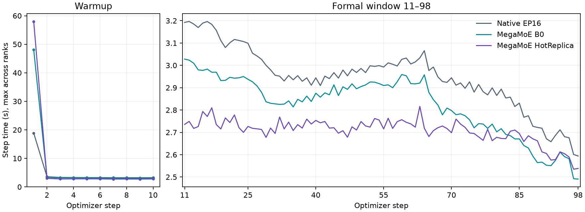
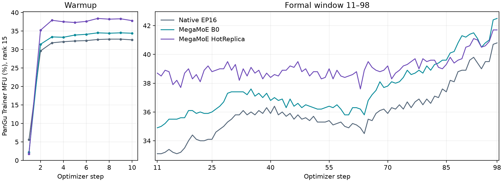
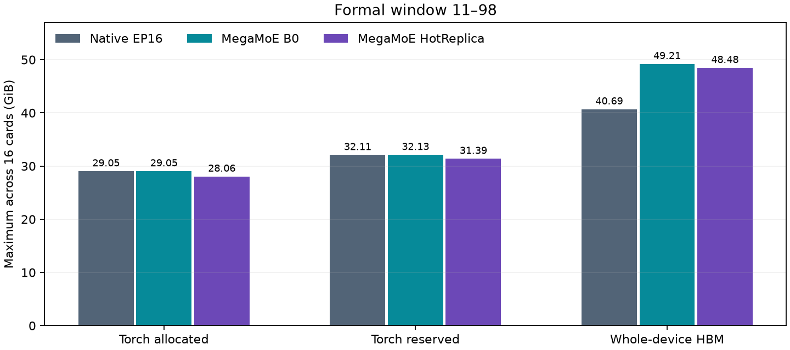
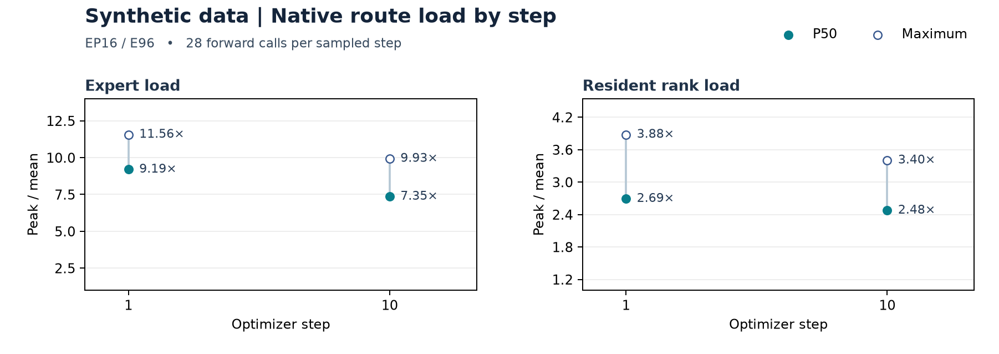
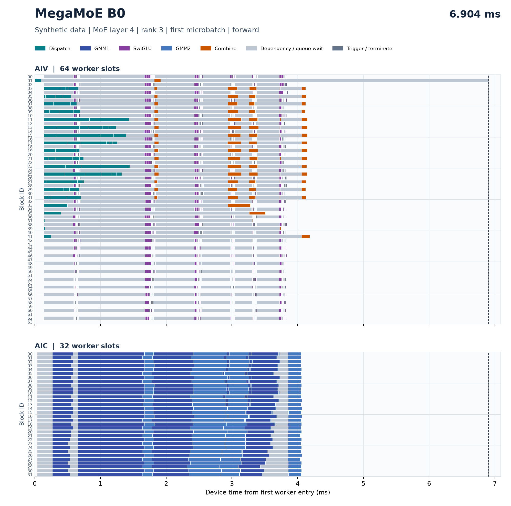
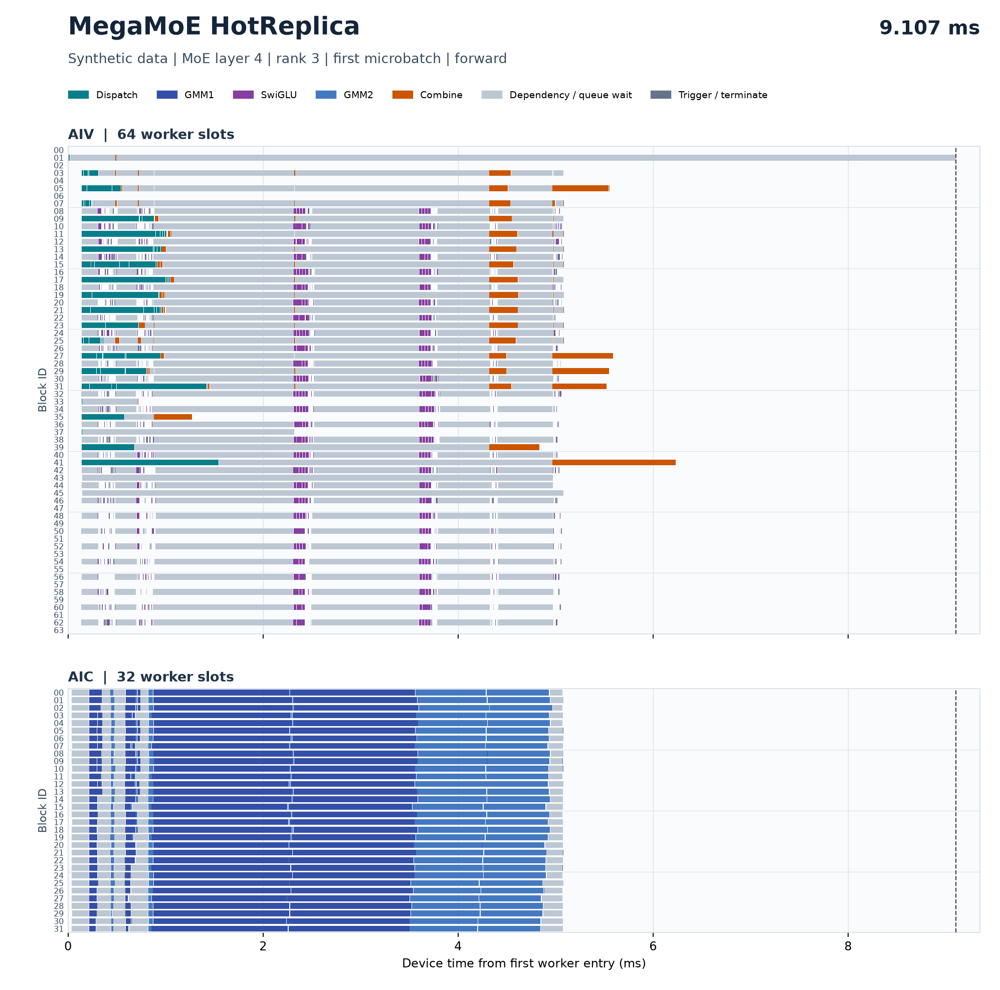
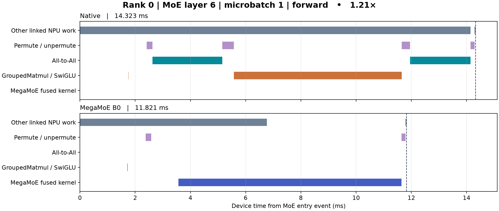

# PanGu A5 双机 MegaMoE 与 Native 性能报告（BF16 合成热点）

实验日期 2026-11-25，运行编号 `20261125-172858-16094f3c`。

## 1. 核心结论

- **关闭副本的 MegaMoE B0 与 Native 在本轮核对的训练数值上零差异。**第 11–98 步，两项 MTP loss 和 Grad norm 的日志最大绝对差均为 **0**，第 1、10、99 步的 Top-K 哈希也一致。
- **MegaMoE B0** 的正式窗口步时 P50 为 **2.860 秒**，较 Native 的 2.954 秒下降 **3.17%**。
- **MegaMoE HotReplica** 的步时 P50 为 **2.718 秒**，较 Native 降时 **7.98%**，较 B0 再降 **4.97%**。正式窗口 4,302/4,576 次调用实际借槽。
- **第 99 步 profiler** 中，B0 和 HotReplica 的七层 MoE 合计加速比分别为 **1.033×** 和 **0.971×**。正式窗口整卡 HBM 采样峰值依次为 **40.69 / 49.21 / 48.48 GiB**。

## 2. 性能对比

### 2.1 双机 16 卡

双机 Ascend950 DT，各八卡。PanGu BF16，EP16/E96、每 rank 六个常驻专家，TopK8、H5120/I1792、序列 4,096、MBS1、GAS4、GBS64、CP1。七个 MoE，六层完整重算，采用 Muon，Engram 关闭。 三臂共用合成序列和初始化种子。每条 packed 样本有 4,097 个 ID，用于 4,096 个训练 token 及后移标签，Router 随训练正常更新。

Native 使用 PanGu 置换、All-to-All 和 GroupedMatmul。两个 MegaMoE 臂使用 BF16 Push，Dispatch/Combine 都按 4,096 行分片，ready lookahead 为 1，UDMA 配置 8 个 QP。B0 使用原属专家，HotReplica 使用默认 auto 规划。三臂在同一双机预留中按 Native、B0、HotReplica 的顺序运行。

| 方案 | 对比基线 | 平均单步耗时（s） | 吞吐提升 | Allocated / Reserved（GiB） | 显存节省 Allocated / Reserved |
| --- | --- | --- | --- | --- | --- |
| Native EP16 | — | 2.947 | — | 29.05 / 32.11 | — |
| MegaMoE B0 | Native EP16 | 2.823 | +4.41% | 29.05 / 32.13 | -0.01% / -0.05% |
| MegaMoE HotReplica | Native EP16 | 2.708 | +8.82% | 28.06 / 31.39 | +3.41% / +2.25% |

| 方案 | P50 / P95（s） | 输入 tokens/s | PanGu 日志 MFU | 整卡 HBM 采样峰值（GiB） | SHMEM heap 配置（GiB） |
| --- | --- | --- | --- | --- | --- |
| Native EP16 | 2.954 / 3.185 | 88,947 | 35.98% | 40.69 | — |
| MegaMoE B0 | 2.860 / 2.980 | 92,866 | 37.57% | 49.21 | 8.00 |
| MegaMoE HotReplica | 2.718 / 2.771 | 96,796 | 39.08% | 48.48 | 8.00 |

### 2.2 专家副本

HotReplica 在正式窗口有 72/88 步比 B0 快。每 rank 有 4,302/4,576 次前向或重算实际走 `fp32_band` 副本协议。第 99 步为 39/52 次。两条 MegaMoE 臂的接收区预留均为 196,608 行，源路由区为 32,768 行，正式窗口零扩容。

每层每微批计算原属 rank 接收量的最大值与均值之比，再在当步样本中取中位。接收量降幅按实际借槽的普通前向统计。

| 采样步 | Native 原属负载峰均比 | HotReplica 落位前峰均比 | 落位后最忙 rank 接收量中位降幅 |
| --- | --- | --- | --- |
| 1 | 2.69× | 2.69× | 62.84% |
| 10 | 2.48× | 2.49× | 59.77% |
| 99 | 1.60× | 1.69× | 42.81% |

同一合成输入有 87.5% 的位置使用六个高频 token，其中一个占全部位置的 70%。相较 75% 高重复位置的短跑，首步最忙专家 / 均值的中位由 7.06× 升至 9.19×，最忙 rank / 均值由 2.27× 升至 2.69×。

#### 与真实数据的路由不均衡程度对比

两组取 Native，保持 EP16/E96 和每 rank 六个常驻专家的口径一致。每个采样步有七层 × 四微批共 28 个样本。专家峰均比为最忙专家行数除以 96 个专家的均值。Rank 峰均比按每 rank 六个原属专家的行数相加后，再以最忙 rank 行数除以 16 个 rank 的均值。表中各列为 28 个样本的中位数和最大值。

| 采样步 | 合成专家 P50 / 最大 | 真实专家 P50 / 最大 | 合成 rank P50 / 最大 | 真实 rank P50 / 最大 |
| --- | --- | --- | --- | --- |
| 1 | 9.19× / 11.56× | 2.87× / 4.20× | 2.69× / 3.88× | 1.38× / 1.83× |
| 10 | 7.35× / 9.93× | 2.58× / 3.71× | 2.48× / 3.40× | 1.36× / 1.60× |
| 99 | 4.51× / 6.89× | 7.75× / 9.61× | 1.60× / 1.92× | 2.07× / 3.15× |

合成组从第 1 到第 10 步的专家和 rank 峰均比都下降，两个采样点的负载都比真实组集中。到第 99 步，合成组两项峰均比进一步下降，真实组的最忙 rank 峰均比则升至最高 3.15×，高于合成组的 1.92×。路由直方图采集于第 1、10、99 步，图中展示合成组的前两个采样点。 [路由采样明细](assets/pangu-a5-ep16-bf16-synthetic/route-skew-comparison.json) · [真实数据报告](pangu_a5_ep16_bf16_real_megamoe_vs_native.md)

### 2.3 统计口径

整步时间来自 PanGu 训练日志。每步先取 16 个 rank 的最大值，再对第 11–98 步统计均值、P50 和 P95。第 1–10 步为预热，第 99 步采 profiler。吞吐按每步 262,144 个输入 token 和正式窗口平均步时折算。MFU 为 rank 15 的 PanGu Trainer 日志值在正式窗口的均值。

表中 allocated 和 reserved 取正式窗口各 rank 的 allocator 高水位最大值。整卡 HBM 用两节点各自的 npu-smi 采样取得。第 99 步的 HBM 采样峰值依次为 40.70 / 49.21 / 48.48 GiB。 [正式窗口审计](assets/pangu-a5-ep16-bf16-synthetic/formal-summary.json) · [逐步 CSV](assets/pangu-a5-ep16-bf16-synthetic/steps.csv)

## 3. 训练数值核对

Native 与 B0 在第 1、10、99 步的 832 个 Top-K 哈希各自全部一致。下表取 rank 15 第 11–98 步的原始训练日志。三臂的学习率在日志精度下逐步一致。 [训练数值回执](assets/pangu-a5-ep16-bf16-synthetic/numeric-audit.json)

| 对照 | MTP head 0 loss 最大绝对差 | MTP head 1 loss 最大绝对差 | Grad norm 最大绝对差 |
| --- | --- | --- | --- |
| Native / MegaMoE B0 | 0 | 0 | 0 |
| Native / MegaMoE HotReplica | 0.010797 | 0.010656 | 2.24167 |
| MegaMoE B0 / MegaMoE HotReplica | 0.010797 | 0.010656 | 2.24167 |

## 4. 配置、数据与日志

- PanGu `0b5e0280ac1ad70d2837b10291c4b3e5ce5c1ff8`，MegaMoE `hot-replica-a5-perf@3d6545d1154a5bfb5ee96b61b62c612ebb7fb023`。 [构建指纹、制品 SHA256 与运行配置](assets/pangu-a5-ep16-bf16-synthetic/provenance.json)
- 逐步 CSV 保留预热、正式窗口及 profiler 步的耗时、MFU、loss、Grad norm 和学习率。 [逐步 CSV](assets/pangu-a5-ep16-bf16-synthetic/steps.csv)
- 三臂 48 个训练 rank 的终态齐全，任务进程清零，两节点共 16 张 NPU 释放。 [运行回执](assets/pangu-a5-ep16-bf16-synthetic/provenance.json)

| 方案 | Trainer case | 路由专家执行 |
| --- | --- | --- |
| Native EP16 | `syn-main-native` | PanGu 原生置换、All-to-All、GroupedMatmul |
| MegaMoE B0 | `syn-main-b0` | `dispatch_mode="push"`，`expert_placement=None` |
| MegaMoE HotReplica | `syn-main-hot` | `dispatch_mode="push"`，`expert_placement=HotReplicaPlanner()` |

### 4.1 Rank 0、8 第 99 步 Level0 Profiling

每份 Trainer trace 的第 99 步标记内有 28 次前向、24 次重算与 28 次路由专家反向。Native 每个采样 rank 在 MoE 范围内有 160 次 `c10d::alltoall_base_`，两个 MegaMoE 臂各有 80 次融合设备内核。

### 4.2 MegaMoE 核内流水

核内 trace 记录 rank 3、9 的第四层首微批，前向、重算、反向三段齐全，四份 trace 均无记录丢失。以 B0 的 rank 3 前向为例，Dispatch 位于 0.004–1.442 ms，GMM1 在 0.271 ms 启动，GMM2 从 1.640 ms 启动，首个 Combine 从 1.820 ms 启动。Cube 与 Dispatch/Combine 活动区间的交集为 1.765 ms。反向最后一个 W1Grad 在 7.630 ms 结束，内核在 12.633 ms 结束，最后一项 Cube 工作后的尾段为 5.003 ms。

| 第 99 步第四层首微批 | B0 前向 / 重算 / 反向（ms） | HotReplica 臂前向 / 重算 / 反向（ms） |
| --- | --- | --- |
| Rank 3 | 6.904 / 6.861 / 12.633 | 7.121 / 7.056 / 13.048 |
| Rank 9 | 6.883 / 6.865 / 12.665 | 7.099 / 6.983 / 13.068 |

正式第 99 步的该层走常驻专家路径。同语料短跑的第 3 步在该层实际启用副本，将该微批的原属 rank 峰值从 125,355 行降到每 rank 32,768 行。

下图各取第 4 层 rank 3 的首微批前向。B0 来自第 99 步，HotReplica 来自实际启用副本的短跑第 3 步。每条泳道对应一个 AIV 或 AIC 的 block ID，彩色区间为任务执行，灰色区间为等待和调度控制。横轴以各自最早的 worker 进核时刻为零，竖虚线标记最后一条记录结束。两张图各自展示所采步的通算重叠。

## 5. MoE 层加速比

使用第 99 步三臂共同的 14 个 rank，核内采样所在 rank 单列。前向和重算的 NPU Event 覆盖整个 MoE 层，包括 Router、共享专家和路由专家。反向覆盖路由专家 autograd。先按 rank 求和再取中位，倍率为 Native 耗时除以候选耗时。

| 方案 | 前向（ms） | 重算（ms） | 路由专家反向（ms） | MoE 合计（ms） | 合计加速比 |
| --- | --- | --- | --- | --- | --- |
| Native EP16 | 371.0 | 303.0 | 504.1 | 1,178.4 | 1.000× |
| MegaMoE B0 | 362.9 | 286.6 | 491.8 | 1,141.3 | 1.033× |
| MegaMoE HotReplica | 420.0 | 319.5 | 479.2 | 1,214.1 | 0.971× |

| MoE 层 | Native（ms） | B0（ms） | HotReplica（ms） | B0 加速比 | HotReplica 加速比 |
| --- | --- | --- | --- | --- | --- |
| 1 | 202.1 | 170.8 | 191.7 | 1.183× | 1.054× |
| 2 | 173.3 | 155.3 | 173.9 | 1.116× | 0.997× |
| 3 | 179.8 | 153.1 | 169.8 | 1.174× | 1.059× |
| 4 | 150.8 | 218.1 | 221.2 | 0.692× | 0.682× |
| 5 | 166.9 | 167.8 | 165.4 | 0.994× | 1.009× |
| 6 | 178.2 | 172.0 | 173.7 | 1.036× | 1.026× |
| 7 | 127.1 | 103.8 | 123.2 | 1.225× | 1.032× |

单列发生核内观测的第 4 层后，其余 6 层的合计中位加速比为 B0 **1.113×**、HotReplica **1.035×**。以上均为第 99 步采样。 [逐层 MoE 耗时与倍率](assets/pangu-a5-ep16-bf16-synthetic/moe-speedup.json)

### 同一 MoE 层的 Native 与 MegaMoE B0 流水

从两组相同前向配对中选取均有明显收益的样本，使用第 99 步、rank 0、第 6 层、第 1 个微批。Native 为 **14.323 ms**，B0 为 **11.821 ms**，该样本加速 **1.21×**。两图使用相同时间刻度，以各自 MoE 入口的 NPU Event 为起点，展示通过 profiler 流事件关联到该前向的设备任务。竖虚线标记各自的退出 NPU Event。灰色包含关联的等待和其他设备任务。 [时间线数据](assets/pangu-a5-ep16-bf16-synthetic/native-vs-b0-timeline.json)

