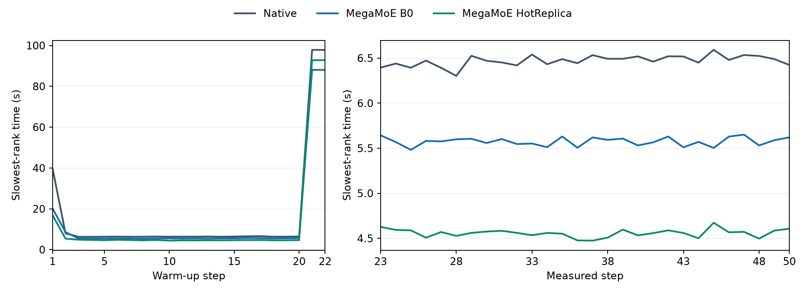
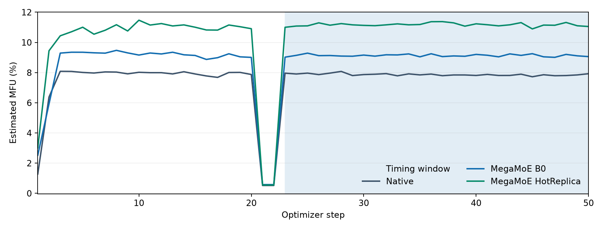
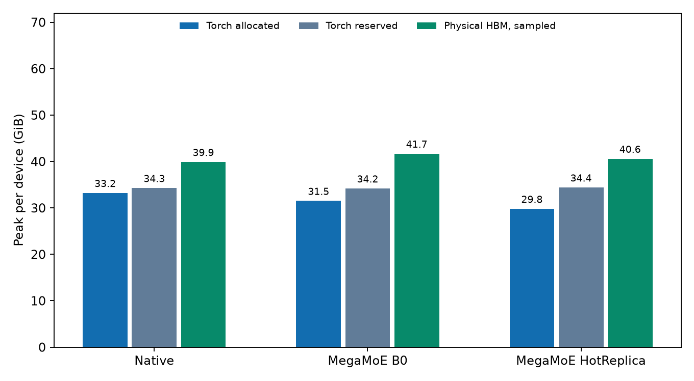

# Qwen3.5-35B-A3B 单机 MegaMoE 与 Native 性能报告（Hyper FSDP＋Hyper Muon std）

实验日期 2026-11-25，运行编号 `20261125-110012-0f7ce4`。

## 1. 核心结论

- **MegaMoE B0** 为 **5.575 秒/步**。相对 Native 的 6.471 秒/步，步时下降 13.84%，吞吐提升 16.07%。
- **MegaMoE HotReplica** 为 **4.559 秒/步**。相对 Native 步时下降 29.55%，相对 B0 再降 18.23%。正式窗口实际采用副本 2,240/2,240 次。
- 整卡 HBM 采样峰值依次为 **39.92 / 41.71 / 40.61 GiB**。三组各完成 50 步，2,400 条 rank-step 与 48 份 rank 终态齐全，退出后 16 卡空闲且设备锁释放。

## 2. 性能对比

### 2.1 单机 16 卡

完整 Qwen3.5-35B-A3B 视觉语言网络，40 个语言 MoE 层，30 层 Gated DeltaNet、10 层全注意力，E256、TopK8、H2048/I512。Ascend A3 单机，16 个 `ascend910_93` 逻辑 NPU，EP16、专家 FSDP1、Hyper FSDP shard16、SP1、GBS16、MBS1、GA1。三组统一使用 BF16、FP32 FSDP 梯度归约、Hyper Muon std、分块交叉熵、FLA-NPU Gated DeltaNet 和非重入重算，启用 checkpoint early stop。

Native 走 VeOmni NPU All-to-All、置换与 GroupedMatmul。两个 MegaMoE 组走 MTE Push，各用一份跨 40 层串行复用的执行资源。B0 使用原属专家。HotReplica 由默认 auto 规划实际落位，每 rank 上限为 16 个 guest 槽。三组依次使用独立的 16 rank 进程，同一轮共用 Triton 编译缓存。分支的 Indexed Push 与单次 R+B 资格限定于 HY106 的 E128/H4096/I1408 路径。本轮 Qwen3.5 使用分支上的常规 BF16 MTE Push。

| 方案 | 对比基线 | 单步耗时（s） | 吞吐提升 | allocated / reserved（GiB） | 显存节省 allocated / reserved |
| --- | --- | ---: | ---: | ---: | ---: |
| Native EP16 | — | 6.471 | — | 33.24 / 34.30 | — |
| MegaMoE B0 | Native EP16 | 5.575 | +16.07% | 31.53 / 34.21 | +5.14% / +0.28% |
| MegaMoE HotReplica | Native EP16 | 4.559 | +41.95% | 29.82 / 34.42 | +10.29% / -0.33% |

| 方案 | P50 / P95（s） | 输入 tokens/s | 估算 MFU | 整卡 HBM 采样峰值（GiB） | SHMEM heap 峰值（GiB） |
| --- | ---: | ---: | ---: | ---: | ---: |
| Native EP16 | 6.476 / 6.537 | 20,255 | 7.87% | 39.92 | 0.000 |
| MegaMoE B0 | 5.579 / 5.638 | 23,510 | 9.13% | 41.71 | 1.834 |
| MegaMoE HotReplica | 4.561 / 4.620 | 28,753 | 11.17% | 40.61 | 0.752 |

### 2.2 专家副本

HotReplica 相对 B0 的吞吐提升为 22.30%，正式窗口中 28/28 步更快。实际副本按 EP 组调用计数，每层前向和重算各算一次。rank 0 的 FP32 band 梯度路径在正式窗口绑定 2,240 次。

正式窗口 B0 和 HotReplica 已提交的接收区上限分别为 415,104 和 81,920 行，对应 SHMEM heap 峰值 1.834 和 0.752 GiB。B0 扩容发生在第 1、2 步，HotReplica 扩容发生在第 1 步。两组第 23–50 步扩容均为 0。

#### MegaMoE B0 路由不均衡度

沿用 PanGu 报告的原属 rank 峰均比。对每层的每次前向或重算，先汇总每个 rank 上 16 个原属专家的接收行数，再用最忙 rank 的行数除以 EP16 的均值。本次每 rank 输入 8,192 个 token，TopK 为 8，平均接收 65,536 行。[PanGu 峰均比口径](pangu_a5_ep16_bf16_real_megamoe_vs_native.md#路由负载随训练变化)

| A3 单机 B0 实验 | 第 1 步最大峰均比约束范围 | 50 步最大峰均比约束范围 |
| --- | ---: | ---: |
| 首轮，Torch FSDP2＋AdamW | 约 5.04–5.05× | 约 5.05–6.31× |
| 本轮，Hyper FSDP＋Hyper Muon std | 约 5.06–5.07× | 约 5.07–6.33× |

第 1 步的最后一次扩容超过了按 1.25 倍增长的容量，因而可以用实际峰值按 128 行向上对齐的规则反推。第 2 步再次扩容，说明两轮最忙 rank 分别超过了 330,752 和 332,032 行。此后接收区固定在 413,440 和 415,104 行，为全程峰值提供上界。[容量记录与精确区间](assets/qwen35-a3-ep16/b0-route-skew.json)

两轮均关闭逐专家采样。第 23–50 步可确认的峰均比上界分别约为 6.31× 和 6.33×，逐层峰均比 P50 和 P95 缺少原始接收计数。

### 2.3 统计口径

每个方案运行一次，共 50 步。步时从训练步前 NPU 同步完成计到步后同步完成，包含取数、前向、反向和优化器更新。每步取 16 rank 中的最大值，再统计第 23–50 步。折算吞吐时每步计 16 × 8,192 个模型输入 token。吞吐提升为基线步时除以候选步时减一。仅 rank 0 采集 Level0 CPU/NPU 时间线，第 17–19 步预热，第 20–21 步采集，使用离线导出。正式计时从第 23 步开始。

各 rank 在训练步末记录 Torch allocated/reserved 的累计峰值，表中取跨 rank 最大值。整卡 HBM 取训练进程存续期间 npu-smi 采样最大值，每轮查询后间隔 2 秒。表中三个整卡峰值均在正式计时窗口采到。SHMEM 列为实际 heap 预算。估算 MFU 使用 VeOmni 的 Qwen3.5 文本和视觉 FLOPs 公式及 Ascend 910_93 每逻辑 NPU 354 TFLOPS 的分母。

原报告的 4.2857 秒来自 Hyper FSDP＋Hyper Muon std 单机 EP1。本轮沿用这一训练栈、模型、数据和计时窗口，三组均用 EP16。加载阶段由 rank 0 读取并广播预训练权重。 [参考报告](https://github.com/Cui-yshoho/hyper-parallel/blob/463045aaf51b5940e7dc85bd09aea3aa0782b0bd/docs/benchmarks/veomni_ablation_report.md)

## 3. 训练数值核对

每对实验的 800 份逐 rank 输入 token、标签和视觉网格指纹以及学习率一致。首步首层的原属专家权重采样和 Top-K 指纹均在 16 个 rank 一致。后续路由由各组训练的模型自行生成。下表为 rank 0 的 50 步日志差值。

| 对照 | Loss 最大绝对差 | Grad norm 最大绝对差 |
| --- | ---: | ---: |
| Native EP16 / MegaMoE B0 | 0.00415637 | 4.80724 |
| Native EP16 / MegaMoE HotReplica | 0.0196461 | 5.63341 |
| MegaMoE B0 / MegaMoE HotReplica | 0.0238025 | 3.02168 |

## 4. 配置、数据与日志

- VeOmni `c8bed6880b0eba04218de23a57f6794ef94969b2`，HyperParallel `master@11483b9fc3f2ee42c245960b30f9327115abb7d2`，MegaMoE `hot-replica-a3-perf@b0d5c3258f72b9ece4f65d734b64cc470530e753`，CANN 9.2.0、Torch 2.12.0+cpu、torch-npu 2.12.0.post3、Transformers 5.16.1、Triton-Ascend 3.6.0.post2。[构建指纹、制品 SHA256 与终态汇总](assets/qwen35-a3-ep16/audit-summary.json)
- 数据为原报告的 32 个 Parquet 文件、4,096 条样本。每条包含两张图像与 20 帧视频，每 rank 处理后为 8,192 tokens。[数据 SHA256](assets/qwen35-a3-ep16/dataset.sha256) · [预训练配置与权重索引 SHA256](assets/qwen35-a3-ep16/model-config.sha256)
- 逐步数据包含 50 步的步时、loss、grad norm、显存、副本落位次数和扩容次数。审计汇总保留各组采样统计、输入指纹比对计数与 16 卡释放记录。[逐步 CSV](assets/qwen35-a3-ep16/steps.csv) · [审计汇总](assets/qwen35-a3-ep16/audit-summary.json)

三组共用 VeOmni 配置，随报告提供的 YAML 将模型、数据和输出目录换成占位路径。实验入口通过 `QWEN_BENCH_CASE` 选择后端，在 FSDP 解分片后将当前层的本地专家权重交给 MegaMoE。[共用 VeOmni YAML](assets/qwen35-a3-ep16/veomni-ep16-8k.yaml)

| 方案 | `QWEN_BENCH_CASE` | 路由专家执行 |
| --- | --- | --- |
| Native EP16 | `native` | VeOmni `fused_npu` |
| MegaMoE B0 | `mega-b0` | `dispatch_mode="push"`，`expert_placement=None` |
| MegaMoE HotReplica | `mega-hot` | `dispatch_mode="push"`，`expert_placement=HotReplicaPlanner()` |

实验归档 `20261125-110012-0f7ce4` 保存训练入口、启动与调度记录、逐 rank 原始审计、三组完整训练日志和 `trace_view.json`。原始报告与审计的 SHA256 写入随附的审计汇总。

### 4.1 Rank 0 Level0 Profiling

下表取第 20、21 步 rank 0 的 CANN 时间分解均值，原始 CSV 使用从 0 开始的步号 19、20。计算、未重叠通信与空闲对应 CANN 的 Computing、Communication(Not Overlapped) 和 Free。MegaMoE 的 SHMEM 通信在融合 kernel 内执行，这段时间计入 Computing。

| 方案 | 计算（s） | 未重叠通信（s） | 空闲（s） | 逐步分析 CSV |
| --- | ---: | ---: | ---: | --- |
| Native EP16 | 2.942 | 2.898 | 0.597 | [step_trace_time](assets/qwen35-a3-ep16/native-step-trace.csv) |
| MegaMoE B0 | 4.521 | 0.653 | 0.455 | [step_trace_time](assets/qwen35-a3-ep16/mega-b0-step-trace.csv) |
| MegaMoE HotReplica | 3.418 | 0.795 | 0.418 | [step_trace_time](assets/qwen35-a3-ep16/mega-hot-step-trace.csv) |

## 5. MoE 层路由专家加速比

用第 20、21 步 rank 0 的 Level0 时间线，按层号对齐 40 个语言 MoE 层。每个方案的前向、重算和反向各有 80 个样本。每个阶段按 `mlp.experts` 首尾关联的 NPU 事件间隔计时，包含期间的通信和等待。完整 MoE 层还包含 Router、共享专家和外层 FSDP 的开销。[逐层 profiler CSV](assets/qwen35-a3-ep16/moe-routed-expert-spans-rank0.csv)

| 方案 | 前向（ms/层） | 重算（ms/层） | 反向（ms/层） | 合计（ms/层） | 相对 Native 加速比 |
| --- | ---: | ---: | ---: | ---: | ---: |
| Native EP16 | 25.06 | 25.54 | 31.25 | 81.85 | 1.00× |
| MegaMoE B0 | 18.97 | 18.20 | 22.48 | 59.65 | 1.37× |
| MegaMoE HotReplica | 12.80 | 13.40 | 9.35 | 35.55 | 2.30× |

开启副本后，相对 B0 的路由专家合计加速为 **1.68×**。收益最大的是反向，从 22.48 ms/层降到 9.35 ms/层，加速 **2.41×**。
