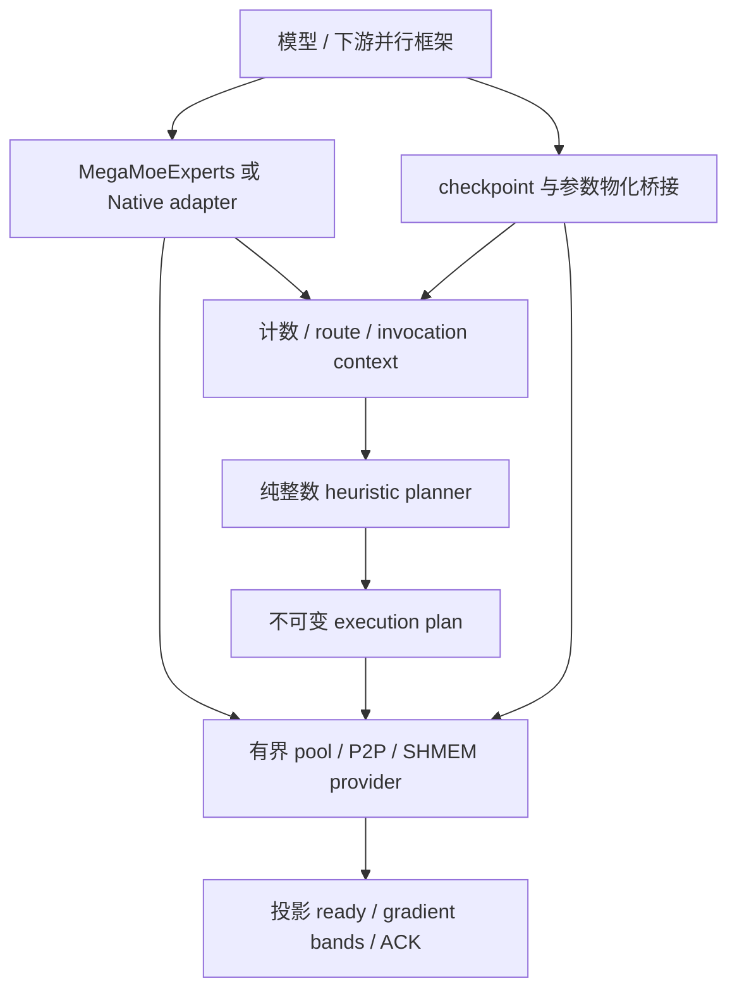

# 专家副本无表版：最小完整迁移与重构方案

## 当前交付与源码边界

本方案先移除成本模型及校准体系，保留生产无表启发式的实际决策。
迁移目标是完整可训练的有界专家副本；规划内核及精确差分之后，已继续接入路由、Native P2P、MegaMoE、对称池和 native 梯度协议。
执行与 DFX 见[独立无表专家副本执行闭环](expert_replica_runtime.zh-CN.md)；设备验收状态以交付 REPORT 为准。

| 项目 | 冻结身份 / 状态 |
| --- | --- |
| 来源 | HyperParallel `expert-hot-replica`，`22ad8d4b3308efba597ca670d2f16b8e4e750863` |
| 目标基线 | HyperMulticore `master`，`0b1d3c7449e53a6d4f6d73fbd7c48cabc5355f4e` |
| 工作分支 | `feat/expert-replica-heuristic` |
| 隔离工作树 | `/home/ma-user/zfr/hyper-multicore-expert-replica-heuristic` |
| 当前实作 | 无表规划、路由/重算/P2P、驻留/信号、MegaMoE 接入、ready/bands/ACK 及隔离构建增量 |
| 当前验收 | 6000 组冻结无表决策精确差分；374 项 CPU UT；105 项桥接 UT；匹配 native 构建及 7 项 host 测试；双卡32条 rank/case 通过；EP32跨分支alpha扫描完成，精简实现有时延回退 |
| 完整迁移状态 | 执行代码已接入；CPU、实际 payload 与下游桥接分开验收并记录 |

来源冻结包包含原分支最新的按需副本矩阵存储改动。已有 RFC 基于更早的 `ae5256724`，
本方案不改写它们的实验基线。目标基线的 `MegaMoeExperts` 仍公开 Push/Pull 等调优参数；
本次没有合并另一个接口精简分支，也不借迁移改动既有业务接口。

## 最小完整版本必须保留什么

“完整”以训练语义和资源安全为边界；成本预测、校准工具和默认关闭的研究变体不属于必需执行链。

| 能力 | 首个完整无表版本的要求 |
| --- | --- |
| 所有权与梯度 | owner 保有参数及 optimizer；guest 不注册参数；FP32 partial 全部归还 owner |
| 无损规划 | 均匀 home 布局、固定 B 上限、逐 source/expert 守恒、无丢弃、无 multi-wave |
| 生产无表策略 | 40% 业务默认门槛、软小副本门槛、容量必需副本、稀疏完成种子、已有矩阵合并与关键专家补齐 |
| 拓扑与流量 | 真实节点身份、rank/node 局部性、source/node 流量约束、有限确定性搜索 |
| 执行 | Native P2P 与 MegaMoE Push/Pull；B0、home-only、实际副本三条路径 |
| 输入与数值 | ragged/empty source、空源非空接收、稳定当前 ID remap、dx/router/dW 与正常优化器更新 |
| 传输 | P2P 基线、投影 ready、gradient bands、整投影回退、credit/ACK 和 FP32 peer 顺序 |
| 生命周期 | invocation-owned plan、F/R/Bwd、延迟与逆序 backward、共享池互斥、stream event、Heap/provider/epoch 失效 |
| 内存 | Push 硬容量、实际对称 Heap 预算、B_max 与活跃槽位区分、共享 B 上限池；按需 inbox 的布局及事务边界保留，默认启用另行验收 |
| 驻留 | saved-generation 复用；普通驻留保留安全 key 与物化失效，不猜测外部 FSDP 版本 |
| 关闭和异常 | 不遗留 remote reader；不复用失败 payload；图、lease、provider 和 process group 顺序可验证 |

无表启发式仍可能在短序列或某些 Pull 负载慢于 B0。移除成本模型不能成为任意负载不回退的承诺，
也不能为了减少代码而移除强制容量、全组一致错误处理或最小完成 fence。

## 第一阶段真正移除和延后的内容

### 从无表版本的运行依赖中移除

- `cost.py`、`critical_path.py`、`policy.py` 及校准 JSON 选择和运行签名匹配。
- `autocalibration.py`、`calibration_catalog.py`、`calibration_audit.py`、`static_band_reference.py`。
- 模型对象、浮点评分、拟合、holdout、profile 安装、quota cost search 和合成性能系数。
- 仅服务于上述体系的观测、采集、自动化脚本和测试矩阵。

原 `hot_replica` 包为6971行 Python，其中上述七个成本/校准模块占2604行。
这只是来源包内的实际计数，不是整个迁移 diff 的缩减比例。
只设置成本开关为0仍会留下 imports、dataclass 字段、实验搜索分支和校准工具，因此不作为裁剪方案。

### 独立延后，不混入首个完整执行闭环

| 项目 | 延后理由 / 保留的基础能力 |
| --- | --- |
| device planner 与其 ABI | CPU planner 已覆盖基本功能；未来单独迁移并验收策略差异 |
| 可选融合 count kernel | 先保留精确 Torch 整数计数；表外回退本来就是合法路径，另测控制开销 |
| 可选 host C++ extension | 先保留 Python reference；如全宽 CPU 准备开销过大，再独立接入必要整数原语 |
| D2 metadata descriptor cache | 默认关闭，额外生命周期和资格证书不适合与基础迁移混合 |
| hot replay readback、local-count upload、packed replay | 独立实验；基础 exact plan replay 与当前 token remap 必须保留 |
| complete/projected guest search 等实验开关 | 保留默认无表生产策略；不为研究变体引入额外 API 和环境变量 |
| 额外梯度队列、lookahead、双缓冲、详细因果 observer | 不改变既有静态 bands 顺序；必要的 ready/fence/ACK 与基础诊断仍保留 |
| 非副本的独立流水调优 | 可以另行评审；不从特性分支批量覆盖目标仓的 B0 实现 |

首阶段移除的是可选加速入口和研究变体，不声称兼容这些旧隐藏开关。
迁移基线以成本关闭、实验搜索关闭的旧默认无表策略为差分参考；后续验收不套用带表结果。

## 模块拆分与依赖方向



核心层不向上 import runtime，独立仓不 import HyperParallel。
已有目标仓构建、loader、SHMEM manager、诊断与业务模块为基线；只接入必需增量。

当前规划层已经拆为：

| 文件 | 单一职责 |
| --- | --- |
| `capacity.py`、`plan.py` | 拓扑/容量界、不可变槽位/配额、transfer 和诊断验证 |
| `admission.py`、`topology.py` | 整数收益门槛、实际节点标签及合法性 |
| `_balance.py` | donor/receiver 骨架、有限补齐和小副本回收 |
| `_selection.py` | 有限预算选择、容量完成、生产稀疏完成种子 |
| `_placement.py` | 整 guest 移动/合并/交换、矩阵边删除与流量检查 |
| `_retained.py` | 仅在已有矩阵内缩短关键专家片段，保留 rank/node 边界 |
| `_dispatch.py` | 最终只物化一次，按 rank/node/source 顺序生成精确配额 |
| `planner.py`、`__init__.py` | 参数边界、明确阶段编排和 CPU 低层入口 |

各函数通过目标仓 CCN≤15、有效行数≤100 的检查，不以整段复制后屏蔽复杂度检查收口。
本层算法只使用标准库；导入仍沿用目标仓根包既有 Torch 诊断依赖，不把它描述成完整包无 Torch。

## 完整执行链的逐文件迁移清单

下表记录已接入的迁移边界；具体数值和资源终态以交付 REPORT 为准。

| 来源能力 | 目标位置 / 操作 | 必须一起完成的闭环 |
| --- | --- | --- |
| `routing.py` 无表部分 | `replica/routing.py` | 共用计数、collective 错误、compact home、当前 IDs、source quotas；删除成本/device/cache实验分支 |
| `_metadata.py` 基础上传 | `replica/_metadata.py` 小型 owned upload helper | pinned source 生存期、nonblocking 上传、consumer stream；不带实验 cache |
| checkpoint resource registry | `replica/recompute.py` | F/R ordinal、exact counts/policy/group、原容量重检、异常和 early-stop 清理 |
| `pool.py`、`transport.py` | `replica/pool.py`、`replica/transport.py` | 共享 B 池、lease/event、P2P wait、有限接收与 consume 所有权 |
| `signal_transport.py`、`residency.py` | `replica/signal_transport.py`、`replica/residency.py` | 投影 ready、当前 ACK、generation、物化 token、按需 storage；去 observer 和旧 env 前缀 |
| `native.py` | `replica/native.py` | packed SwiGLU、FP32 partial、可微 All-to-All；只抽取必要通信 Function，不搬整个通信工具模块 |
| MegaMoE module/spec | 修改既有 `modules/mega_moe/module.py`、`spec.py` | logical/physical E、B0/home/replica 选择、组内 manifest、配置拒绝 |
| MegaMoE route/function | 修改既有 `route.py`、`function.py` | 保存独占 backward 输入、FP32 dW、逆变换、guest prefetch 和归还 |
| workspace/heap | 修改既有 `workspace.py`、`heap_manager.py` | 对称 inbox、实际预算、活动 lease 禁止增长、按需矩阵 storage 与 provider 重建 |
| plan/graph/storage | 修改 `plan.py`、`backward/graph.py`、`backward/storage.py`，接入小型 `kernel_gradients.py` | home 与 guest 地址、dW fence、空专家初始化和安全回退 |
| 物理 guest 任务裁剪 | 从 `inactive_tasks.py` 只抽必需部分 | 不执行空 guest、不破坏 event 配额；不带成本匹配与实验队列分支 |
| native 梯度与发布 | runtime 的 `replica_gradient.h`、`gradient_band.h`；worker 和 GMM band patch 的必要增量 | W2/W13 生产 fence、空 producer、静态 return worker、投影 quorum、ACK |
| 构建与封装 | 当前 dependency lock、source assembly 和 native manifest 的最小增量 | patch SHA、双向算子一起构建、同包 ABI；不覆盖现有工具链与缓存机制 |
| SHMEM SDMA | 在既有 Python API、Torch binding 和 CANN host 层补齐映射 peer copy | 权重投影和 ready 的当前 stream 顺序；低层 `put/get` 默认参数保持兼容 |

`gradient_band_observer.h`、完整 profiler decoder、模型 examples、集群报告和历史采集脚本不随 runtime 迁移。
SHMEM 数据面已经属于独立仓，不重复导入另一份 runtime。
来源 `.cpp/.h` 中除功能外还有 namespace、缓存、队列等变化，必须按协议片段挑选并编译验证，
不能把“归一化路径后还能 apply”当作 native 等价。

## 下游桥接：不把框架依赖倒灌进独立仓

### Native EP

`ExpertParallel` 的 mesh 分区、hooks 和 `GroupedExperts` 拥有关系留在 HyperParallel。
它们通过薄 adapter 调用独立仓的 dispatch/native experts/combine；共享 planner、route、transport 只保留一份。
业务模型无需改 router 语义，guest 不变成第二份参数。

### checkpoint

独立仓拥有通用 invocation state 和 context；下游 checkpoint wrapper 把原 F 与 R 绑定同一调用。
非重入模式可通过 `context_fn` 接入；重入模式需要明确的 wrapper，不能仅凭 `grad_enabled` 猜阶段。
必须记录 balanced/home-only 旁路，防止后续热调用 ordinal 错配。
缓存命中仍执行本次全组计数、容量检查和当前 ID remap。

### FSDP / HSDP

物化证据必须由实际更新完整参数的框架提供。建议独立仓提供小型参数物化标记接口，
下游在重新 all-gather 后刷新；它只表示新物化代次，不替换 autograd version。
该 API 已在 `replica/residency.py` 实现；下游物化 hook 在隔离桥接工作树验证。

没有权威物化证据的外部权重，普通跨调用驻留应保守 miss；不能单靠 pointer 和 Torch version 命中。
原 saved-generation 的合法复用和每次梯度 epoch/ACK 继续独立维护。
不能为少改几行而丢掉来源 `hsdp_param.py` 中的安全保护。

### 对外接口

当前执行接入只新增 keyword-only `replica_slots_per_rank`，默认0。
无表默认策略、传输和 planner 由组件内部解析；低层研究控制不回流到模型构造器。
不保留已经移除的成本模型参数，也不保留接受参数但不生效的兼容壳。
原有 EIO/EOI、Push/Pull 和 `from_module` 合同独立检查；正预算 EOI 在未实现前仍明确拒绝。

## 有序实施与完成门槛

| 步骤 | 交付物 | 放行条件 | 当前状态 |
| --- | --- | --- | --- |
| 1 | 独立无表 planner 与不可变计划 | 精确 source/slot/dispatch/transfer 差分；边界/复杂度门 | 本轮已实现 |
| 2 | CPU route + P2P + invocation + Native adapter | 当前 ID、empty/ragged、逆序 Bwd、P2P FP32 归还；mock 与独立 CPU 功能门 | CPU 与双卡 Native 数值门通过 |
| 3 | MegaMoE Python 接入和对称 Heap 事务 | B0 回归、home-only、按需 inbox、图/lease/growth/close 的组合门 | CPU 及双卡 Push/Pull 数值门通过；默认共享 B 上限存储 |
| 4 | native ready/bands/ACK 与最小构建增量 | 真正构建并加载当前 payload；CPU C++ harness 与 NPU 数值/生命周期门 | 构建、host harness、真实 kernel 两投影与设备释放通过 |
| 5 | 下游 checkpoint/FSDP hooks | 相同权重/路由，GAS、重算、物化、两次更新及状态对齐 | CPU合同及真实EP2/DP2 FSDP通过：单机四卡、双机各两卡、两种reshard策略 |
| 6 | 指定形状迁移性能与独立Trainer验收 | EP32/E192/H5120/I1792/TopK8/BF16/T4096；同输入跨分支alpha扫描；另验B0和Trainer | 跨分支ABBA/BAAB完成，Push/Pull变化中位数+1.23%/+1.08%；完整Trainer及峰值HBM待验 |

第2～5步必须共同完成才称为“功能完整的独立仓迁移”。第1步单独不能给模型传新参数，
也不能把 planner 通过当成设备、SHMEM 或整网已可用。
每步形成小的可审阅变更；若分别提 PR，各 PR 按自身功能范围收敛，不把整条历史分支合入目标仓。

## 本轮可复现入口与验证记录

在本分支的独立 editable 环境中：

```bash
python -m pytest tests/ut/replica -q
python scripts/check_repository.py
python scripts/pre-commit/run_pylint.py hyper_multicore/replica/*.py tests/ut/replica/*.py
python scripts/pre-commit/run_lizard.py hyper_multicore/replica/*.py tests/ut/replica/*.py
```

纯 CPU 规划入口示例（可训练组件用法见[执行闭环 RFC](expert_replica_runtime.zh-CN.md)）：

```python
from hyper_multicore.replica import build_expert_replica_plan

plan = build_expert_replica_plan(
    ((4096, 0, 0, 0),) * 2,
    replica_slots_per_rank=1,
    minimum_replica_rows=1024,
    minimum_load_reduction=0.4,
)
plan.validate()
```

6000组差分包含4363个合法计划、1637个一致拒绝，其中2513个实际副本计划、1480个容量必需计划，
683组含空source。比较完整逻辑计数、槽位、逐source dispatch、destination counts和有序transfer，
refactor前后结果摘要均为 `a2fa515c2b3b4a8ab7ebd0e1802158408afad43d35ea57e8a62da8519b24b6a4`。
参考扩展与实验搜索关闭，不把不同策略的计划混入等价声明。

完整 CPU 回归为374项、2098个子例；下游桥接回归为105项。既有CANN安装归属和pytest marker
warning单列，不当作功能失败。Pylint、Lizard、Markdownlint及独立仓检查分别保存日志。
新增和修改的native patch已更新dependency lock并真正重编译；SHMEM的7项host测试通过。
下游AutoGit全文件门存在未改动HSDP代码的基线失败，详见REPORT，不将局部UT通过等同于整门通过。

本机冻结参考、复现脚本、环境、精确差分与清单保存在：
`/home/ma-user/work/z00961864/expert-replica-minimal-migration-20261109/`。
`migration-inventory.json`记录来源文件指纹和移除/延后分类；`compare_planners.py`可重建同种子输入。
设备数值门使用本轮源码及匹配native payload；指定EP32性能对照已生成独立新结果，不复用旧资格证书。
协议、逐点样本、图和资源终态见[EP32性能RFC](expert_replica_performance.zh-CN.md)，
交付目录为`ep32-alpha-comparison/REPORT-EP32-alpha-comparison.md`。

## 仍需实测的风险

纯 Python 阶段去掉可选 host 扩展，意味着计划一致不等于 CPU 延迟一致；
指定EP32的跨分支对照已观察到回退，因果定位仍需分别测量计数、readback、规划与执行开销。
减少成本体系和实验代码可以缩小维护面，不能自动消除 near-balance 开销。

普通驻留与外部FSDP桥接、reentrant重算、按需inbox增长及native band发布，
是需要持续验收的主要边界。首版默认共享B上限存储，旧payload不能执行新增协议。
独立构建和双卡组件ST已通过；后续EP2/DP2 FSDP单机/双机组合也已通过。
完整Trainer、其他FSDP拓扑和峰值HBM尚未验收；
小形状FSDP组合记录见交付目录`fsdp-integration/REPORT-fsdp-integration.md`，不作为指定形状的迁移性能验收。
当前性能结论见[EP32性能RFC](expert_replica_performance.zh-CN.md)：数值和计划保持一致，仍存在时延损失。
分支保留本地，未push或发布PR。
