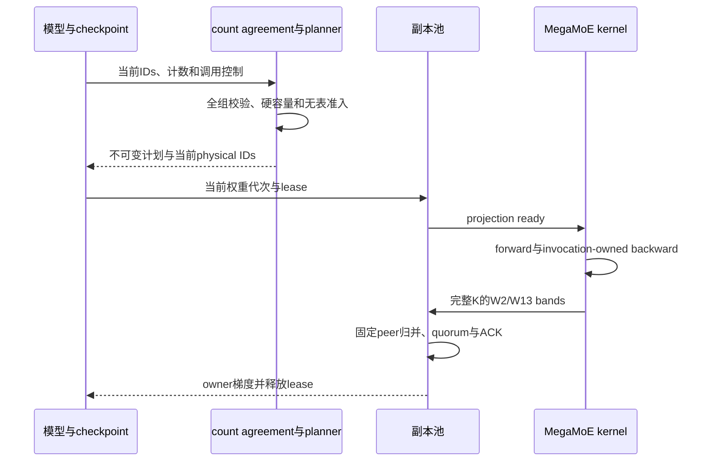

# RFC：无表专家副本执行

## 动机（Motivation）

热点路由使固定专家布局下的计算和通信集中于少量owner。方案在有界guest存储内分摊实际token，
保持原参数、优化器及梯度所有权。规划只使用精确整数计数、拓扑和容量，不引入离线成本模型。
公共用法见[专家副本指南](../expert_replica.md)。

## 目标设计

owner参数不复制为新参数；guest持有当前执行的两路权重和FP32梯度partial。
规划器生成不可变的物理槽位、source/expert配额和transfer表，当前token据此重新映射。
同一EP组的各层共享有界副本池，lease保证互斥，激活和反向状态按调用持有。

### 实现边界

| 位置 | 职责 |
| --- | --- |
| `replica/capacity.py`、`plan.py`、`planner.py` | 容量、不可变计划及纯整数阶段编排 |
| `replica/_balance.py`、`_selection.py`、`_placement.py`、`_retained.py` | 有界搜索、必要容量修复及拓扑/流量约束 |
| `replica/routing.py`、`_dispatch.py` | 精确agreement、source配额、当前ID重映射 |
| `replica/recompute.py` | F/R ordinal和调用上下文，含home-only旁路 |
| `replica/pool.py`、`transport.py`、`residency.py` | lease、stream event、权重驻留与物化失效 |
| `replica/signal_transport.py` | credit、投影ready、epoch、ACK及saved generation |
| `replica/native.py`、`communication.py` | P2P基线和可微all-to-all |
| `modules/mega_moe/` | B0/home/guest、Heap事务、invocation-owned反向状态及任务裁剪 |
| `ops/runtime/`与GMM replica patch | 完整K生产、band发布、FP32归并及reader完成 |

依赖方向为业务执行器调用规划/传输，独立仓不导入HyperParallel。
普通整数host扩展不可用时回退Python；融合count不支持时回退精确Torch路径。

## 需要设计评审DFX建议

### 数据和控制一致性

非法ID、重复TopK、无效计数、超大尺寸及autograd参与不一致，必须在稀疏传输前全组协调拒绝。
可信histogram仍检查shape、dtype、总量和逐expert上界；内容与当前IDs一致是调用方合同。
计划复用要求逐source/expert精确一致、相同group/rank/policy及当前容量；计数相同不代表permutation相同。

常规副本使用行峰值降幅与软小副本门槛；两个权重投影均需训练梯度时采用25%门槛并计入梯度搬运代价，
其他情况采用40%门槛。为满足硬容量所必需的副本保留独立规则。
B只限制槽位上界，不强制所有调用借用副本；不丢弃、不多轮、不按alpha选择实验策略。

### 重算与资源生命周期

每次forward和重算都执行新的agreement。F/R ordinal包含home-only调用，防止热/冷混合错配。
原权重由autograd保存版本；多个deferred forward各自保存激活、路由与反向输入。

权重copy stream只在对应projection完成后发布ready；执行stream通过event等待。
驻留命中仍完成当前credit/ready/ACK；receiver不自行决定跳过payload。
失败、物化变更、provider/Heap重建和epoch rollover使缓存失效。
没有外部物化证据时保守miss，显式标记不替代Torch参数版本。

### 梯度归还

W2/W13分别预留epoch和completion storage。band只在完整K最终GM store的现有FIX完成依赖后发布；
没有输出tile的producer也发布贡献。owner按稳定peer顺序FP32累加，所有worker结束后才发ACK。
投影不能分别选择不匹配的协议；缺少双投影证明时共同回退。
最终BF16与紧凑scratch见[最终梯度协议](expert_replica_final_gradient_output.zh-CN.md)。

### 兼容性与影响范围

B0和正预算副本均支持EIO和连续EOI；guest矩阵、gradient band及Heap扩容预算按实际布局计算。
首次绑定前布局未知的其他层按两种布局中较大的副本资源预留。Push硬容量与Pull暂存限制分别保留。
沿用接口分支的动态设备核数和SHMEM构建合同，不把24/48写成所有设备的固定容量。
参数继续由调用方持有；副本预算通过实验性调优选项传入，稳定数值选项保持独立。
当前副本完整性能证据来自Ascend910_93，不能外推为其他设备验收。

SHMEM `put/get(use_sdma=True)`在当前stream复制到可映射peer，无法映射时报错；
返回只表示入队，接收方仍依赖ready/ACK。默认调用保持原RMA路径。

### 替代方案与验证

B0/owner-only是无收益或无证明时的执行路径；Native P2P是独立参考传输。
研究队列、metadata replay和按需inbox保留明确开关，详见[执行控制](expert_replica_default_paths.zh-CN.md)。
不删除complete-K fence、ACK或错误协调来减少差分，也不把CPU规划结果等同于训练性能。

CPU覆盖整数规划、容量、回放、lease、双投影布局和正常队列选择；设备ST覆盖训练和重算。
完整性能须匹配源码、实际原生库、路由、输入、优化器和逐rank终态，见[性能协议](expert_replica_performance.zh-CN.md)。

## 相关RFCs和API

副本预算新增到 `MegaMoeTuningOptions.replica_slots_per_rank`，默认 `0`。
调用方持有参数并在forward显式传入；Push/Pull与容量属于调优选项，激活和概率语义属于稳定数值选项。
低层CPU入口为 `ExpertReplicaConfig`、`ExpertExecutionPlan`、`ExpertReplicaTransfer`及
`build_expert_replica_plan`，位于 `hyper_multicore.replica`。
外部框架可调用 `mark_replica_weights_materialized` 使驻留证据失效。
协议、私有研究字段和环境变量不扩展为新的业务构造参数。
