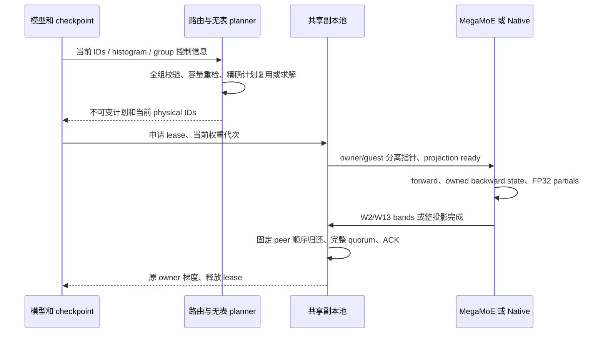

# RFC：独立无表专家副本执行闭环

状态：实施中；按 HyperParallel `003-RFC.yml` 的必填字段组织。本文对应独立仓
`feat/expert-replica-heuristic`，与[迁移方案](expert_replica_migration.zh-CN.md)共同评审。

## 动机（Motivation）

原特性分支把启发式、成本拟合、校准、实验搜索、框架 hooks 和设备协议放在同一条差分中。
仅关闭成本开关仍然依赖其类型、文件和运行签名，也难以审阅训练正确性。
本次将可训练的有界副本收敛到独立组件；框架只提供原参数、调用上下文与物化证据。

## 目标设计

owner 保有参数、梯度及优化器。guest 只借用每个 EP group 共享的有界执行存储，
不注册新参数。规划器只使用精确整数计数、真实节点拓扑和固定无表准入规则。
实际路由保留逐 source/expert 配额并重映射本次 token；重复计数不能充当 token permutation 缓存。



### 模块边界

| 模块 | 职责 |
| --- | --- |
| `replica/routing.py` | 一次精确 count agreement、错误协调、硬容量和当前 ID remap |
| `replica/recompute.py` | invocation registry；原 forward 与重算共享；包括 home bypass ordinal |
| `replica/native.py`、`communication.py` | Native P2P dispatch/combine、grouped experts、可微 all-to-all |
| `replica/pool.py`、`transport.py` | 有界普通池、互斥 lease、stream event、FP32 peer 顺序归还 |
| `replica/residency.py` | owner 授权的驻留证据、物化失效、slot 全局写入历史 |
| `replica/signal_transport.py` | credit、projection ready、epoch、ACK、saved generation |
| `modules/mega_moe/` | B0/owner/guest 执行、owned backward state、Heap 事务、静态任务裁剪 |
| `ops/runtime/` 与锁定 GMM patch | complete-K band 发布、FIX fence、归还和释放 reader 的完成边界 |

初版业务构造器只新增 `replica_slots_per_rank`。启发式沿用默认 40% receive-peak 降幅门槛和
1024 行软小副本门槛；容量必需副本保留其独立规则。实际 Heap 上限由当前分配器给出。
B 是上限，均衡或无足够收益的调用可执行 owner-only 计划。

## 需要设计评审 DFX 建议

### 正确性与故障语义

- 任何 rank 的非法 ID、重复 TopK、错误计数、超大尺寸或 autograd 参与不一致，必须在稀疏传输前拒绝。
  Router 提供的 histogram 是可信输入合同；其 shape、类型、总量和逐 expert 上界仍参与检查。
- 重算每次仍执行新的全组 agreement。只有逐 source/expert 完全相同、group/rank/policy 相同且符合
  当前硬容量的计划才能复用；F/R ordinal 记录也包括均衡旁路。
- forward/backward 保存 owner 参数，让 Torch 检查版本。多个 deferred forward 的激活与 route 各自拥有，
  允许逆序 backward；不把 graph 绑定到 workspace 的最近一次调用。
- 权重 copy stream 只发布当前 projection ready。驻留命中仍走当前 credit/ready/ACK；
  receiver 不独立决定跳过 payload。失败、provider/Heap 重建、epoch rollover 都使缓存失效。
- 两路投影分别预留 epoch 与 completion storage。bands 必须等完整 K 的最终 GM store fence；
  空 producer 也发布贡献。归还维持固定 peer 顺序，并在所有消费者结束后发 ACK。
- 不能证明 bands 可用时，两路投影一致回退到整投影协议；不能只让某一投影进入不匹配的协议。
- 外部参数没有物化证据时普通驻留保守 miss。框架在 all-gather 或 `.data` 更新后调用
  `mark_replica_weights_materialized`；该标记不替代 Torch autograd version。

### 兼容性与影响范围

保留目标基线的 EIO/EOI 参数布局及 B0 调度；正预算 EOI 仍明确拒绝。
Pull 的暂存字节限制、B0 route/header cache、CPU 可导入及原独立构建/loader 边界继续保留。
事件尾部统一增加完整 expert producer fence 的预留；较大 expert 配置的事件数组会增加少量槽位，
测试需按新的容量计算，不能把序列化字节与旧版完全一致作为兼容条件。

独立仓不导入 HyperParallel。下游桥接把 `ExpertParallel`、GroupedExperts、checkpoint registry 和
完整参数物化 hooks 指向独立实现；框架 mesh、并行切分与参数所有权继续由下游维护。
原框架中的私有历史 multicore 模块不属于新的独立 API。

### 最小性与替代方案

| 选择 | 取舍 |
| --- | --- |
| 直接合并来源分支 | 携带成本/校准、device planner、研究开关及非副本调优，差分难以审阅 |
| 只保留 planner | 可做 CPU 差分，但缺少可训练执行、参数代次和远端 reader 完成语义 |
| 全部改成普通 P2P | 保留为 Native 基线，不能覆盖 MegaMoE 的投影重叠和 native bands |
| 当前选择 | CPU 精确无表 planner + Native P2P + MegaMoE 默认 bands；共用 route 和生命周期合同 |

不引入成本表、自动校准、device planner、D2 descriptor cache、动态梯度队列或因果 observer。
首版默认矩阵存储为共享的 B 上限；按需 prefix 的存储布局和增长接口保留边界测试，
尚不把按需分配打开为业务默认。后续若启用，需另验预算重规划及全组增长事务。

### 性能影响和验收边界

无表准入是负载启发式，不能保证任意形状或任意 B 都比 B0 快。
CPU 精确差分验证策略保持；mock/host harness 验证控制流；当前 native payload 的两卡 ST 验证
实际数值和完成协议。性能与 Trainer 结果需另用同输入、同后端 B0、profiler-off ABBA 和全 rank
终态记录；初版数值 ST 不作性能验收。

## 相关的 RFCs 和 API

```python
from hyper_multicore import MegaMoeExperts
from hyper_multicore.replica.recompute import replica_checkpoint
from hyper_multicore.replica.residency import mark_replica_weights_materialized

experts = MegaMoeExperts(
    hidden_size=512, intermediate_size=512, num_experts=8, top_k=2,
    ep_group=ep_group, replica_slots_per_rank=1,
)
output = replica_checkpoint(experts, hidden, topk_ids, probabilities)
# 外部框架完成一次完整参数物化后：
mark_replica_weights_materialized(gate_up_weight, down_weight)
```

`replica_checkpoint` 默认非重入，也支持显式 `use_reentrant=True`。
已有框架 wrapper 可通过 `create_recompute_contexts` 组合自己的 context，而不重复持有另一份 registry。
Native EP 通过 `dispatch_native_replicas`、`native_replica_experts` 和 `combine_native_replicas` 组成闭环。

验收入口：

```bash
pytest -q tests/ut
pytest -q tests/torch/test_expert_replica.py
python scripts/check_repository.py
```

设备 ST 覆盖 Push/Pull、Native P2P、B0、热/均衡、ragged/空 source、两种 checkpoint、
两次更新及逆序 deferred backward。各 rank 分别保存终态、实际 transfer、梯度投影和最大误差。
完整实验状态记录在交付 REPORT；没有终态证据的项目不能按通过处理。

## 完整的反馈期限

待维护者安排；本文不自动发布 issue 或设置评审截止日期。

## CC List

待维护者补充。

## 其他补充说明

构建使用独立仓原 dependency lock、隔离 source assembly 和发布前 source hash 校验。
新增 replica GMM patch 也进入 SHA 校验；构建期间源码变化时拒绝发布混合 payload。
所有迁移与桥接均使用独立工作树，原始文档和来源特性分支保留。
